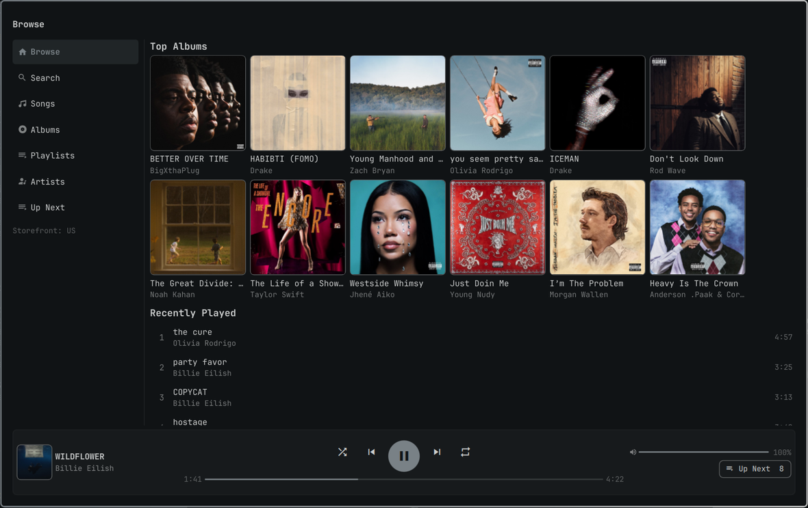
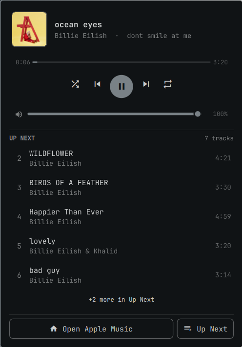

# Apple Music for Omarchy

A native Apple Music player for the [Omarchy](https://omarchy.org) shell — catalog
and library browsing in a full window, pause/skip/seek right under the bar icon,
and playback through mpv. No Electron, no browser at runtime.

The web player (Cider and friends) is a browser wrapped around MusicKit: it works,
but it costs half a gigabyte of memory and a second Chrome to play a song. Apple
serves the same 256 kbps AAC stream to Chrome as Widevine; decrypting it locally
lets mpv do the playing, which is smaller, seekable, cacheable and already speaks
MPRIS.



## Using the bar icon

The bar cell is a now-playing dropdown, not just a launcher:

- **Left click** — seek, transport, volume and Up Next without opening the
  window. Hover or Tab into a row and Enter acts on it; `m` mutes, `n`/`p` skip,
  `,`/`.` seek, `o` opens the window.
- **Right click** — the full window: Home, Browse, Search, your library, the
  queue, and sign-in.
- **Middle click** — play/pause.
- **Wheel** — volume, or seek, per the `wheelAction` setting.



The bar title is capped by `maxLabelWidth` (120 by default, in the shell's
spacing units) and longer titles scroll; set it to `0` to leave only the glyph.

In the window, the cover in the footer opens the album that is playing and the
artist line opens the artist, so a song heard somewhere can be followed back to
its record without a search.

## Shape

- **Plugin** (`io.github.hominluo.apple-music`), kinds `service`, `bar-widget`
  and `overlay` — the same contract the Omarchy Podcast plugin uses.
- **UI** in QML on `qs.Ui` / `qs.Commons`, so themes, motion, keyboard focus,
  translations and bar behaviour come from the shell rather than being faked.
- **Daemon** in Python behind the service: Apple Music API for metadata, one
  cached credential, local Widevine decryption, and mpv over its JSON IPC.
- **Transport** published through MPRIS by `mpv-mpris`, so media keys,
  `omarchy.media` and the bar work without extra plumbing.

## How a track is played

1. The daemon asks the web-playback endpoint for the signed HLS playlist of a
   song (`aac-web`, i.e. the 256 kbps asset the web player uses).
2. The playlist is one fMP4 file addressed by byte ranges, with an
   `#EXT-X-MAP` init segment and `#EXT-X-KEY:METHOD=ISO-23001-7` carrying a
   `data:;base64` key id.
3. That key id is packaged as a `WidevinePsshData` and exchanged for a content
   key with the licence server, using an Android L3 CDM.
4. `ffmpeg -decryption_key` turns the fragments into a plain `.m4a` in the
   audio cache.
5. mpv plays it over `mpv-mpris`. The next tracks are built while the current
   one plays, so a queue is gapless and a replay is instant.

## Requirements

- Omarchy with Quickshell (the plugin targets the 0.3-era plugin API).
- `ffmpeg`, `mpv` and `mpv-mpris`.
- Python 3.11+ (the daemon creates a private venv for `pywidevine` on first
  run; nothing is installed system-wide).
- A browser for sign-in only: Chrome, Chromium, Brave or Edge.
- An Apple Music subscription.
- A Widevine L3 device file (`.wvd`, see below).

## Install

The plugin is a directory the shell scans:

```sh
git clone https://github.com/hominluo/omarchy-apple-music ~/Github/omarchy-apple-music
ln -s ~/Github/omarchy-apple-music ~/.config/omarchy/plugins/io.github.hominluo.apple-music
omarchy restart shell
```

Then add **Apple Music** from the bar widget picker. The daemon starts with the
service; `omarchy-shell io.github.hominluo.apple-music ping` answers `pong`
once it is up.

## Remove

```sh
rm ~/.config/omarchy/plugins/io.github.hominluo.apple-music   # the symlink
rm -rf ~/.local/share/omarchy-apple-music ~/.cache/omarchy/apple-music
omarchy restart shell
```

The daemon and mpv exit with the service; `pkill -f apple-musicd` is the
fallback if the shell was killed on top of them. Settings, cache and the
sign-in profile live only in the two directories above.

## Footprint

Measured on this laptop with a 1920×1080 shell (PSS, which counts shared
library pages once):

| | idle | playing |
| --- | --- | --- |
| `apple-musicd` (Python) | 29 MB, 0.02% CPU | 30–54 MB, 0.1% CPU |
| `mpv` | 39 MB, 0.05% CPU | 56 MB, 1.6% CPU |

The window is QML inside the shell, so it adds no process of its own. The
daemon's upper figure is after the first track has been built: importing
pywidevine and its protobuf/openssl stack is what maps the extra pages, and
they stay warm for the next track. There is one daemon and at most one mpv: a
lock stops a second daemon, mpv dies with its parent even on `SIGKILL`, and an
idle mpv is released after five minutes and started again for the next track.
No Electron, no Chromium, no Node.

## Sign-in

Signing in is a real window, not a token field. The plugin opens
`music.apple.com` in a dedicated Chrome profile
(`~/.local/share/omarchy-apple-music/chrome`), you log in there once, and the
daemon keeps the `media-user-token` (mode 0600) for later API and licence
calls. The window closes itself when it has the token.

The token is read from the profile's cookie database and, if Chrome has not
flushed yet, from the live page over the DevTools port. Signing out deletes the
stored token; the profile is left in place.

## Widevine device

Apple's streams are CENC-encrypted and cannot be played without a Widevine
licence. Drop an L3 `.wvd` at `engine/device.wvd`, or point
`APPLE_MUSIC_WVD` at one. The file is gitignored because it is device-bound and
not redistributable.

## Cache and settings

```
$XDG_DATA_HOME/omarchy-apple-music/    account.json, chrome/, venv/, settings.json
$XDG_CACHE_HOME/omarchy/apple-music/   audio/, artwork/, engine.log
```

`settings.json` holds `storefront`, `language`, `codec`, `prefetch` (tracks
resolved ahead), `cacheLimitMb` (default 1024) and `volume` (0–130, the level
the player comes back at). Old audio is pruned when the cache is over the limit;
the daemon never deletes the track that is playing.

## IPC

```sh
omarchy-shell io.github.hominluo.apple-music status
omarchy-shell io.github.hominluo.apple-music playPause
omarchy-shell io.github.hominluo.apple-music next
omarchy-shell io.github.hominluo.apple-music openView album '{"id":"1441133277","library":false}'
```

The daemon itself speaks NDJSON on `$XDG_RUNTIME_DIR/omarchy-apple-music/daemon.sock`
(`{id, cmd, params}` in, `{id, ok, result}` out, plus unsolicited
`snapshot`/`player`/`nowPlaying`/`queue`/`auth`/`build` events).
`apple-musicd.py probe <song id>` runs the whole chain for one track and prints
the decoded file, which is the quickest way to tell a catalogue problem from a
decryption one.

## Limits

- Apple's private web-playback endpoint and the licence exchange are
  undocumented and can change without notice.
- One account, one storefront (from the token). No lyrics, video, radio or
  lossless.
- Library playlists have no artwork of their own; the first track's cover is
  shown instead.
- The bar cell appears once per monitor but the window is a single overlay.

## License

MIT (see `LICENSE`). The engine imports [pywidevine](https://github.com/devine-dl/pywidevine),
which is GPL-3.0-only; a binary distribution of the two together is therefore
GPL-3.0. The Widevine device file is not distributed here at all.
