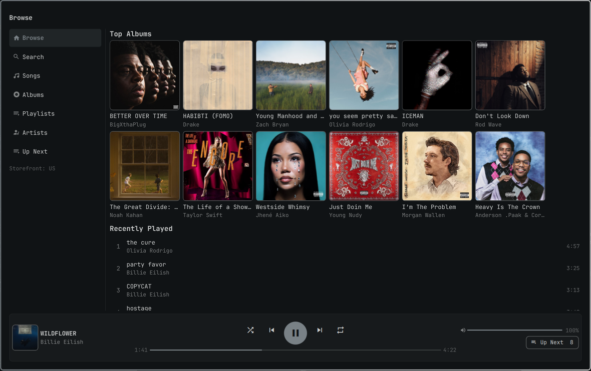
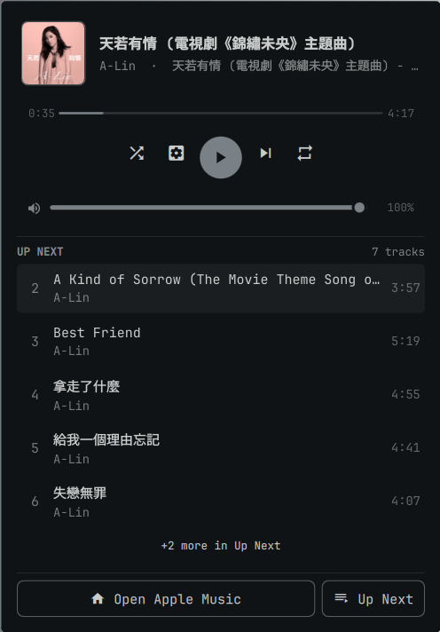

# Apple Music for Omarchy

A native Apple Music player for the [Omarchy](https://omarchy.org) shell — Home,
New, Radio, search and your library in a full window, pause/skip/seek right under
the bar icon, and playback through mpv. Apple Music 1 and the other live
stations play too. No Electron, no browser at runtime.

The web player (Cider and friends) is a browser wrapped around MusicKit: it works,
but it costs half a gigabyte of memory and a second Chrome to play a song. Apple
serves the same 256 kbps AAC stream to Chrome as Widevine; decrypting it locally
lets mpv do the playing, which is smaller, seekable, cacheable and already speaks
MPRIS.



## Using the bar icon

The bar cell is a now-playing dropdown, not just a launcher:

- **Left click** — seek, transport, volume and Up Next without opening the
  window.
- **Right click** — the full window: Home, New, Radio, Search, your library,
  the queue, lyrics, and sign-in.
- **Middle click** — play/pause.
- **Wheel** — volume, or seek, per the `wheelAction` setting.

In the dropdown, the arrows or `h`/`j`/`k`/`l` move a cursor over the rows and
Enter acts on the row under it. Space plays/pauses, unless you moved the
cursor with the keyboard, in which case it acts on that row. `m` mutes, `n`/`p`
skip, `,`/`.` seek ten seconds, `s` shuffles, `r` cycles repeat, `o` opens the
window and `q` opens the queue in it. Tab moves to the next bar dropdown and
Escape closes.

`omarchy-shell io.github.hominluo.apple-music.panel toggle` opens the dropdown
on the focused monitor, for a keybinding.



The bar title is capped by `maxLabelWidth` (120 by default, in the shell's
spacing units) and longer titles scroll; set it to `0` to leave only the glyph.
Like the Podcast cell, the title is a playing indicator: pause and the cell goes
back to just the music note.

## The window

The pages are the web player's:

- **Home** — your recommendations: Top Picks, Recently Played, playlists and
  stations made for you, new releases for you.
- **New** — Apple's editorial page, its charts and playlists, and every genre
  page (Browse by Genre at the bottom).
- **Radio** — the stations you played last, Apple Music 1 and the other live
  stations, local and international broadcasters, radio shows and their
  episodes, interviews, and the genre stations.
- **Search** — songs, albums, artists, playlists, stations and shows.
- **Library** — Recently Added, Artists, Albums, Songs, Playlists.

Every shelf with more behind it has a See All. Artist pages have the same
sections as on the web (Top Songs, Albums, Singles & EPs, Similar Artists…).
A song's menu (the ⋯ on its row, or a right click) has Play Next, Play Later,
Create Station, Favorite, Add to Library and the links to its album and
artist. **Lyrics** in the footer shows the playing song's lyrics, following
along when Apple has them timed. When the queue runs out, Autoplay keeps going
with similar music, as on the web; set `autoplay` to `false` to stop there.

In the window, Space plays/pauses, `←`/`→` skip, `/` goes to Search and `q`
to the queue (all of them stay out of the way while you type in the search
field). Escape goes back a view; on the first view it closes the window. In
Search, the first Escape clears the field.

In the window, the cover in the footer opens the album that is playing and the
artist line opens the artist, so a song heard somewhere can be followed back to
its record without a search.

A track that is not in the cache yet is downloaded and decrypted before it
plays. Meanwhile its title shows with "Preparing…" and the step it is on, and
seeking waits until it is loaded. A live station shows LIVE and the show on
air instead of a seek bar. If it cannot be built, it shows as
unavailable with the reason and the queue moves on.

Your library loads a page at a time: scroll to the end, or press Load more.
Playing a song from it queues the songs loaded so far. Very long playlists and
artist discographies are cut off at what the player fetches, and the page
says so.

## Shape

- **Plugin** (`io.github.hominluo.apple-music`), kinds `service`, `bar-widget`
  and `overlay` — the same contract the Omarchy Podcast plugin uses.
- **UI** in QML on `qs.Ui` / `qs.Commons`, so themes, motion, keyboard focus,
  translations and bar behaviour come from the shell rather than being faked.
- **Daemon** in Python behind the service: Apple Music API for metadata, one
  cached credential, local Widevine decryption, and mpv over its JSON IPC.
- **Transport** published through MPRIS by `mpv-mpris`, so media keys,
  `omarchy.media` and the bar work without extra plumbing.

## How radio is played

A live station never ends and an episode runs for hours, so neither is built
into a file first. The daemon asks Apple where the station's stream is (the
same `play/assets` call the web player makes) and serves mpv a decrypted copy
of it from a small HTTP server on `127.0.0.1`: mpv reads the station's HLS
playlist from there, and each segment it asks for is fetched from Apple,
decrypted with the content key from the radio key server, and handed over as
plain MPEG-TS. mpv's own HLS reader follows the live edge and seeks within
episodes. The server answers only on the loopback interface and only on paths
that start with a random token the daemon gives its own mpv. Broadcasters
(NPR, iHeartRadio, TuneIn stations) are not encrypted and go to mpv as Apple's
URL directly. Genre, artist and song stations hand out songs, which play like
any other track; the next batch is fetched before the queue runs out.

## How a track is played

1. The daemon asks the web-playback endpoint for the signed HLS playlist of a
   song (`aac-web`, i.e. the 256 kbps asset the web player uses).
2. The playlist is one fMP4 file addressed by byte ranges, with an
   `#EXT-X-MAP` init segment and `#EXT-X-KEY:METHOD=ISO-23001-7` carrying a
   `data:;base64` key id.
3. That key id is packaged as a `WidevinePsshData` and exchanged for a content
   key with the licence server, using an Android L3 CDM.
4. `ffmpeg -decryption_key` turns the fragments into a plain `.m4a` in the
   audio cache.
5. mpv plays it over `mpv-mpris`. The next tracks are built while the current
   one plays, so a queue is gapless and a replay is instant.

## Requirements

- Omarchy with Quickshell (the plugin targets the 0.3-era plugin API).
- `ffmpeg`, `mpv` and `mpv-mpris` — all in Omarchy's base install.
- Python 3.11+ (the daemon creates a private venv for `pywidevine` on first
  run; nothing is installed system-wide).
- A browser for sign-in only: Chromium (stock Omarchy), Chrome, Brave or Edge.
- An Apple Music subscription.
- A Widevine L3 device file (`.wvd`, see below). This is the one piece the
  standard install cannot supply.

## Install

```sh
omarchy plugin add https://github.com/hominluo/omarchy-apple-music --enable
```

Add **Apple Music** from the widget picker if it is not in the bar yet. The
daemon starts with the service; `status` shows whether the player is
connected:

```sh
omarchy-shell io.github.hominluo.apple-music status
```

The first start builds the private venv, which takes a little while. If the
daemon cannot start (no `mpv`, a broken venv, a pip failure), the bar tooltip,
the dropdown and the window header say "unavailable" with the reason, which is
also written to `engine.log`. The service then retries a few times and after
that once a minute; opening the window or the dropdown, or pressing play,
retries at once.

### The one manual step: the Widevine device

Drop an L3 `.wvd` into the installed plugin, or point `APPLE_MUSIC_WVD` at it:

```sh
cp device.wvd ~/.config/omarchy/plugins/io.github.hominluo.apple-music/engine/device.wvd
```

Everything else — the private venv, the sign-in browser profile, the caches —
the daemon creates itself.

### Local development

```sh
git clone https://github.com/hominluo/omarchy-apple-music ~/Github/omarchy-apple-music
ln -s ~/Github/omarchy-apple-music ~/.config/omarchy/plugins/io.github.hominluo.apple-music
omarchy restart shell
```

## Remove

```sh
omarchy plugin remove io.github.hominluo.apple-music
rm -rf ~/.local/share/omarchy-apple-music ~/.cache/omarchy/apple-music
```

Disabling or removing the plugin (`plugin remove` disables it first) stops
the daemon and mpv. The daemon runs only while the shell's config,
`~/.config/omarchy/shell.json`, has the plugin enabled by the shell's own
rule: its id is not in `disabledPlugins`, and it sits in the bar layout or in
`plugins`. The daemon checks that before it starts mpv and again whenever the
file changes, so a disable lands within a few seconds, also while the daemon
is still starting or after the shell was killed. A missing, half-written or
unversioned file counts as enabled, so saving the config never stops the
music. Deleting the plugin's folder by hand stops it too. A shell
restart or hot-reload leaves the file alone: the music keeps playing and the
new shell reconnects. After a plugin update the shell finds the daemon from
the old release still running and replaces it once, so playback stops and
the new engine starts. Settings, cache and the sign-in profile live only in
the two directories above.

## Footprint

Measured on this laptop with a 1920×1080 shell (PSS, which counts shared
library pages once):

| | idle | playing |
| --- | --- | --- |
| `apple-musicd` (Python) | 29 MB, 0.02% CPU | 30–54 MB, 0.1% CPU |
| `mpv` | 39 MB, 0.05% CPU | 56 MB, 1.6% CPU |

The window is QML inside the shell, so it adds no process of its own. The
daemon's upper figure is after the first track has been built: importing
pywidevine and its protobuf/openssl stack is what maps the extra pages, and
they stay warm for the next track. There is one daemon and at most one mpv: a
lock stops a second daemon, mpv dies with its parent even on `SIGKILL`, and an
idle mpv is released after five minutes and started again for the next track.
No Electron, no Chromium, no Node.

## Sign-in

Signing in is a real window, not a token field. The plugin opens
`music.apple.com` with the first Chrome, Chromium, Brave or Edge it finds, in a
dedicated profile of its own (`~/.local/share/omarchy-apple-music/chrome`).
You log in there once, and the daemon keeps the `media-user-token` (mode 0600)
for later API and licence calls. The browser closes itself as soon as the
daemon has a token Apple accepts. It also closes when sign-in is cancelled, and
after ten minutes.

The token is read from the live page over a DevTools port that listens on
loopback only and exists only while that window is open, and, once the browser
has written it, from the profile's cookie database.

When there is no stored token, the daemon looks for an existing Apple Music
session cookie when it starts. By default it reads only the plugin's own
profile; set `importBrowserCookies` to `true` in `settings.json` (and restart
the daemon) to also read your Chrome, Chromium, Brave and Edge profiles
(Default and every `Profile N`). That import reads only the
`media-user-token` cookie, using that browser's keyring secret when the cookie
is encrypted. So if you already use Apple Music in one of those browsers,
opting in signs you in without doing anything.

If Apple stops accepting the token mid-session, the window and the dropdown
say so and offer Sign in again. Sign out (in the window header, also while the
token is rejected; press it twice to confirm) deletes the stored token, and the Apple cookies and site storage
in the plugin's own profile. Your daily browsers are left alone. Sign out
sticks: the daemon stops searching for a session at startup until you sign in
again yourself.

## Widevine device

Apple's streams are CENC-encrypted and cannot be played without a Widevine
licence. Drop an L3 `.wvd` at `engine/device.wvd`, or point
`APPLE_MUSIC_WVD` at one. The file is gitignored because it is device-bound and
not redistributable.

## Cache and settings

```
$XDG_DATA_HOME/omarchy-apple-music/    account.json, chrome/, venv/, settings.json
$XDG_CACHE_HOME/omarchy/apple-music/   audio/, artwork/, engine.log
```

`settings.json` holds:

- `storefront`: only a fallback until the account is known; the catalogue
  follows your subscription's storefront, which the window's sidebar shows.
- `language` and `codec`.
- `importBrowserCookies`: default `false`. When `true`, startup discovery
  also reads the `media-user-token` from your daily Chrome, Chromium, Brave
  and Edge profiles, not just the plugin's own profile. Restart the daemon
  after changing it.
- `prefetch`: tracks built ahead of the one playing; 0 turns it off.
- `autoplay`: default `true`. When the queue runs out, keep playing a station
  seeded from the last songs, as the web player's Autoplay does.
- `volume`: 0–100, the level the player comes back at after a restart. A
  saved 0 stays muted.
- `muteRestore`: the level unmute goes back to. Mute (`m` in the dropdown, or
  the speaker icon) saves the current level here, so unmuting works after a
  restart too.
- `cacheLimitMb`: default 1024. After each new track is built, the oldest
  audio is deleted until the cache fits. The tracks in use (the one playing,
  the ones prefetched, and any built in the last minute) are never deleted,
  so the cache can go over the limit by those few files, and 0 means "keep
  only those".

`apple-musicd.py call clearCache` empties the audio cache but keeps the track
that is playing.

## IPC

```sh
omarchy-shell io.github.hominluo.apple-music status
omarchy-shell io.github.hominluo.apple-music playPause
omarchy-shell io.github.hominluo.apple-music next
omarchy-shell io.github.hominluo.apple-music mute
omarchy-shell io.github.hominluo.apple-music volume 40
omarchy-shell io.github.hominluo.apple-music openView album '{"id":"1441133277","library":false}'
omarchy-shell io.github.hominluo.apple-music openView radio '{}'
```

The daemon itself speaks NDJSON on `$XDG_RUNTIME_DIR/omarchy-apple-music/daemon.sock`
(`{id, cmd, params}` in, `{id, ok, result}` out, plus unsolicited
`snapshot`/`player`/`nowPlaying`/`queue`/`auth`/`build`/`settings`/`engine`
events and `notice` messages). Replies can come back out of order, so match
them by `id`. `apple-musicd.py call <command>` sends one command by hand;
`call quit` stops the daemon and mpv, though the service starts them again
while the plugin is enabled.
`apple-musicd.py probe <song id>` runs the whole chain for one track and prints
the decoded file, which is the quickest way to tell a catalogue problem from a
decryption one.

## Limits

- Apple's private web-playback endpoint and the licence exchange are
  undocumented and can change without notice.
- One account, one storefront (your subscription's). No music videos or
  video interviews (they are left off the pages), no lossless or Spatial
  Audio (the web player has neither), and no social features.
- Library playlists have no artwork of their own; the first track's cover is
  shown instead.
- The bar cell appears once per monitor but the window is a single overlay.

## License

MIT (see `LICENSE`). The engine imports [pywidevine](https://github.com/devine-dl/pywidevine),
which is GPL-3.0-only; a binary distribution of the two together is therefore
GPL-3.0. The Widevine device file is not distributed here at all.
